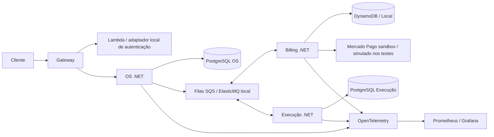

# Arquitetura da demonstração Fase 4

OS é dona do pedido e do estado do processo; Execução é dona do catálogo/estoque e da execução física; Billing é dono do orçamento e pagamento. Outbox/Inbox e chaves de idempotência sustentam a Saga sobre filas. Recusa de pagamento libera reserva quando necessário; falhas ambíguas/estorno podem exigir `ManualReview`.

Na execução local verificada, `ElasticMQ`, `DynamoDB Local`, PostgreSQL, APIs e observabilidade rodam em Docker. O adaptador local exerce o contrato de autenticação da Lambda. Os manifests K3s, Terraform AWS e pipelines representam o caminho de deploy, mas só devem ser chamados de implantados após smoke e evidência remota.
